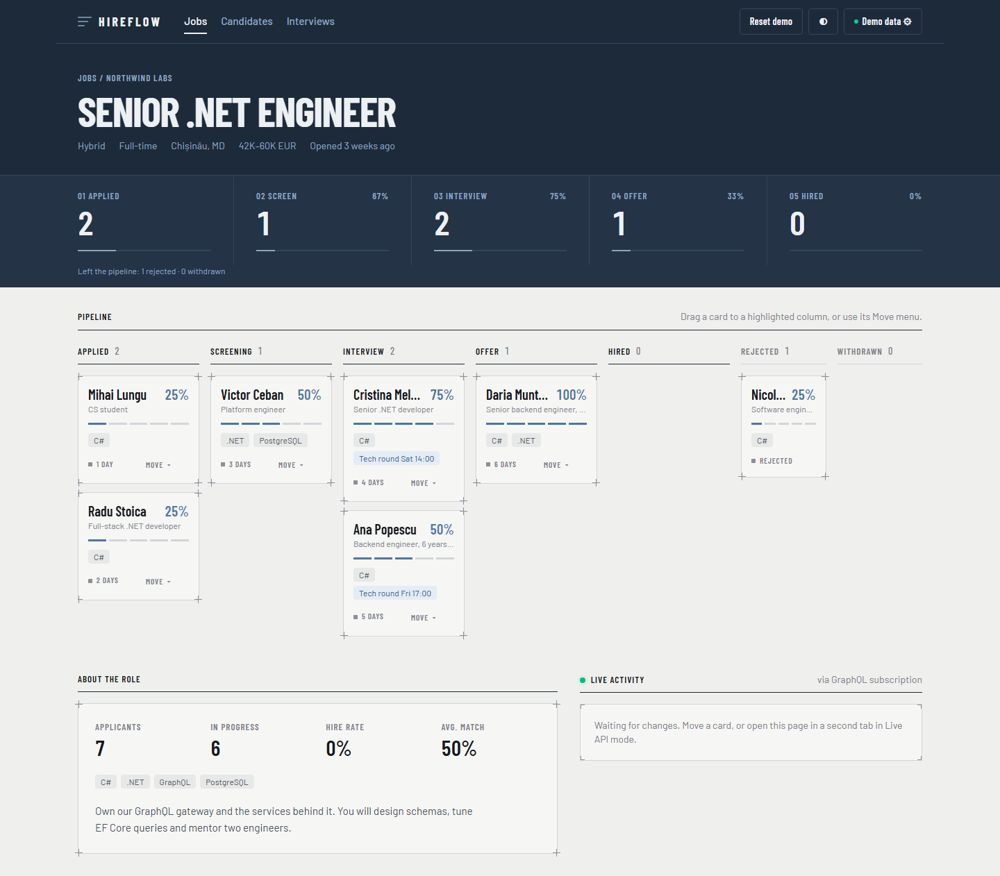
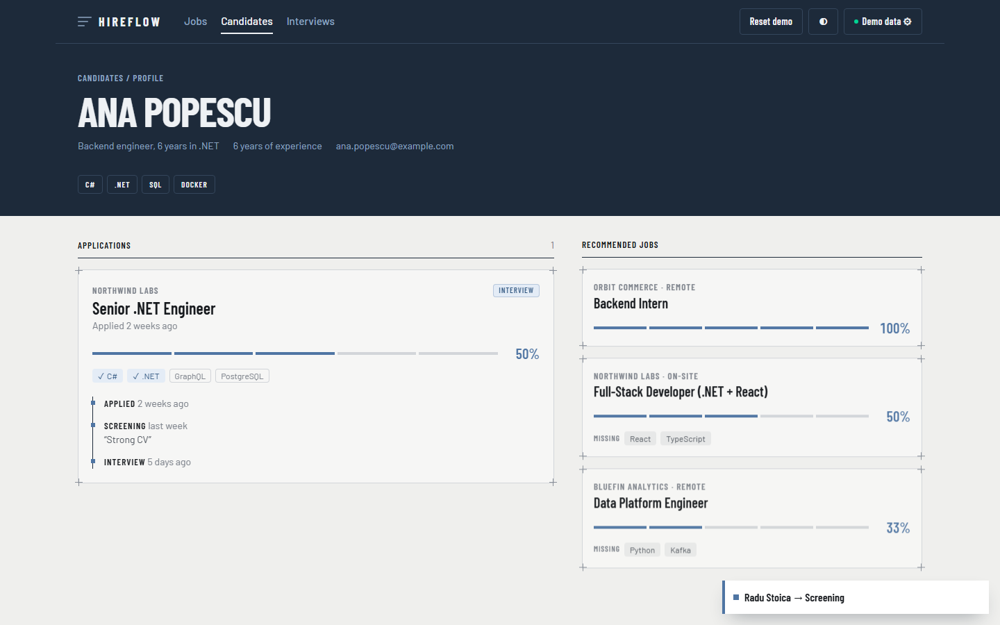
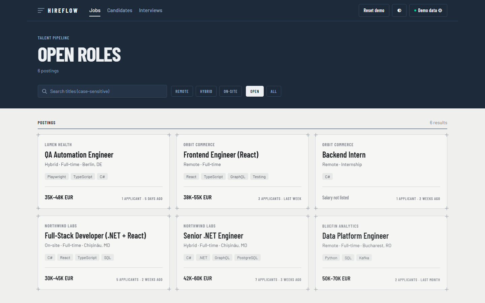
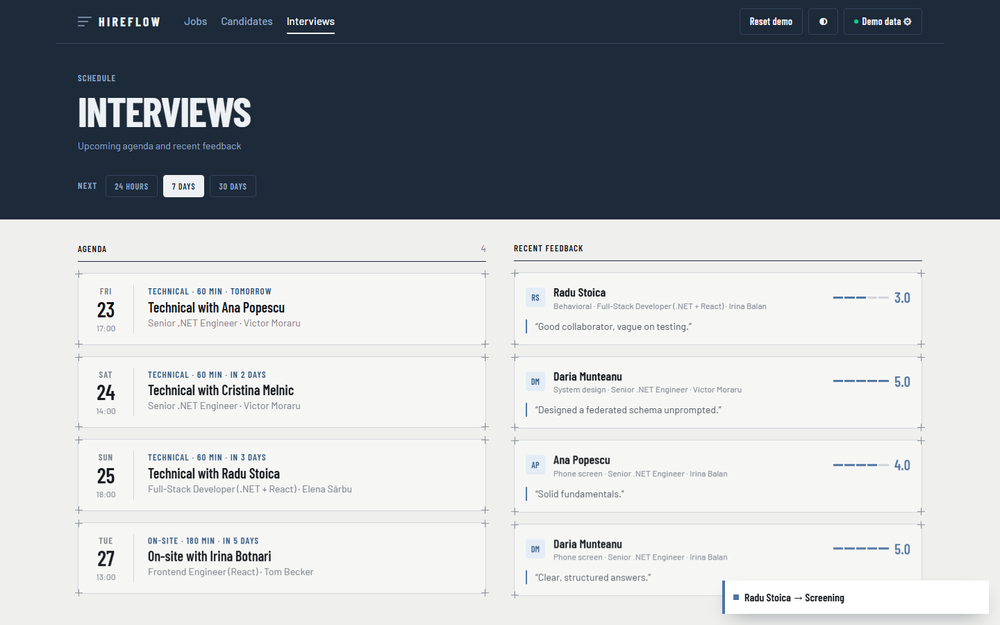
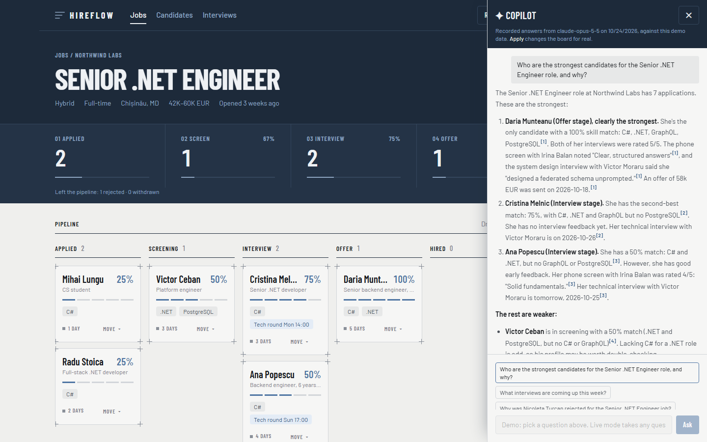
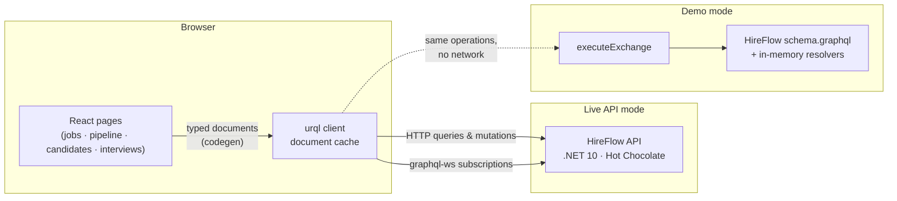

<div align="center">

# 🧭 HireFlow Web

**A recruiter's pipeline board for the [HireFlow GraphQL API](https://github.com/AutumnTrace/hireflow): drag candidates through hiring stages, watch changes arrive live, and see who fits which role.**

Built with **React 19**, **TypeScript**, **urql** and **GraphQL Code Generator**.

[](https://github.com/AutumnTrace/hireflow-web/actions/workflows/ci.yml)
[](https://github.com/AutumnTrace/hireflow-web/actions/workflows/deploy.yml)


[](LICENSE)

### [▶ Try the live demo](https://autumntrace.github.io/hireflow-web/)

<sub>Runs entirely in your browser. No sign-up, no server.</sub>

</div>

<p align="center">
  
</p>

---

## ✨ Highlights

| | |
|---|---|
| 🎨 **Industrial design language** | Navy masthead, condensed Barlow display type, hairline rules, blueprint corner marks and staggered entrance motion (reduced-motion aware), all from semantic tokens with a hand-tuned dark theme. |
| 🗂️ **Drag-and-drop pipeline** | Move candidates between stages with [dnd-kit](https://dndkit.com). Valid target columns light up while you drag; invalid ones dim. |
| 🧯 **Server-driven rules** | The board doesn't hard-code the hiring rules. Each card carries `allowedNextStages` from the API, and an illegal drop shows the API's own typed `InvalidStageTransitionError`. |
| 📡 **Live updates** | A GraphQL **subscription** over `graphql-ws` pushes stage changes; open two tabs and watch one update the other. |
| 🔒 **End-to-end types** | Every query is checked against the API's `schema.graphql` at build time, and the results are fully typed. CI fails if the generated types drift. |
| 🎯 **Skill matching** | Cards and profiles show 5-segment skill-match meters, matched/missing skills and ranked job recommendations from the API. |
| ⏱️ **Pipeline health** | Numbered stage counters with stage-to-stage conversion, days-in-stage on every card, and a *stalled* flag for applications untouched for over a week. |
| ✦ **AI copilot** | A side panel backed by [HireFlow Copilot](https://github.com/AutumnTrace/hireflow-copilot) (Claude + RAG). Answers cite the HireFlow records they come from, and each citation links to that job or candidate. Changes the agent proposes wait for you to click **Apply**, which runs `moveApplication` with the app's own session. |
| 🧪 **Demo mode** | The real HireFlow schema executes **in the browser** against sample data, so the public demo works without a backend while using the same operations, paging, filtering and errors. |
| ♿ **Accessible** | Every drag has a keyboard/menu alternative; columns, meters and charts carry labels and a screen-reader table. |
| 🌗 **Light & dark** | Semantic colour tokens with a system/light/dark toggle. |

<table>
  <tr>
    <td width="50%"></td>
    <td width="50%"></td>
  </tr>
  <tr>
    <td align="center"><sub>Dragging: allowed stages are outlined, the invalid target turns red</sub></td>
    <td align="center"><sub>Candidate profile: skill match, history, recommendations</sub></td>
  </tr>
  <tr>
    <td width="50%"></td>
    <td width="50%"></td>
  </tr>
  <tr>
    <td align="center"><sub>Job board: search and filters in the masthead, cursor pagination</sub></td>
    <td align="center"><sub>Interview agenda and recent feedback</sub></td>
  </tr>
</table>

<p align="center">
  
</p>
<p align="center"><sub>The copilot ranking the Senior .NET pipeline, with citations back to each application</sub></p>

## 🚀 Quick start

```bash
git clone https://github.com/AutumnTrace/hireflow-web.git
cd hireflow-web
npm install
npm run dev
```

Open http://localhost:5173. It starts in **Demo mode**, with nothing else to run.

### Connect to the real API

1. Run the [HireFlow API](https://github.com/AutumnTrace/hireflow) on port 5230:
   ```bash
   dotnet run --project src/HireFlow.Api --launch-profile http
   ```
2. In the web app, click **Demo data ⚙** → **Live API** → leave the URL empty → **Save**.

The Vite dev server proxies `/graphql` (HTTP and WebSocket) and `/auth` to the API, so no CORS setup is needed in development. The app signs in through the API's development token endpoint as a demo recruiter.

> To point at an API on another origin, enter its URL in settings and add this site to the API's `Cors:AllowedOrigins`.

### The copilot

In **Demo mode**, the **✦ Copilot** panel replays real answers that Claude gave about this exact demo dataset (recorded with the copilot's `scripts/record_answers.py`). It shows the recording date, and **Apply** on a proposed move changes the in-browser board for real. Nothing calls an AI service, so the public demo costs nothing to run.

In **Live API** mode, it calls a running [HireFlow Copilot](https://github.com/AutumnTrace/hireflow-copilot) and takes any question:

```bash
# in hireflow-copilot, with ANTHROPIC_API_KEY in .env
COPILOT_SOURCE=graphql COPILOT_HIREFLOW_URL=http://localhost:5230/graphql uv run hireflow-copilot
```

The copilot URL (default `http://localhost:8000`) is under **Live API** in settings. After you apply a change, the panel asks the copilot to re-index, so its next answer sees the new stage.

> The demo dataset is shared with the copilot through `scripts/export-demo-data.ts`, so names, stages and application ids in recorded answers match the board.

## 🏗 How it works



- **One contract.** `schema.graphql` is synced from the API repo (`npm run schema:pull`). Codegen checks every operation against it, and demo mode executes the *same SDL*, so demo and live behaviour can't drift silently.
- **Demo backend** ([`src/demo`](src/demo)): `@graphql-tools/schema` makes the SDL executable over a deterministic dataset. A small interpreter ([`query.ts`](src/demo/query.ts)) implements Hot Chocolate's `where`/`order`/cursor-paging conventions, and the resolvers mirror the API's state machine and typed errors. It's lazy-loaded, so live mode never downloads it.
- **Moves** call the `moveApplication` mutation. Valid moves update the card immediately, then the job is refetched for fresh funnel counts. If the API returns a typed error, the card snaps back and a toast shows the server's message.

## 🔬 Things I found by testing against the real API

Building the client surfaced two real API issues, which were fixed upstream:

- **[hireflow#9](https://github.com/AutumnTrace/hireflow/pull/9):** Hot Chocolate had inferred a domain method as a query field (`JobApplication.moveTo`). Code generation exposed it. Also added CORS for browser clients.
- **[hireflow#10](https://github.com/AutumnTrace/hireflow/pull/10):** filtered queries that pass `where` as a **variable** were rejected by cost analysis (cost 4,777 vs. a 1,000 limit). Hot Chocolate prices filter variables at 5× their worst case. The fix tunes the multiplier and budget, with regression tests that replay this app's queries.

The job board also requests a fixed page size (`first: 12`, with **Load more**) so the server can price each request accurately.

## 📁 Project structure

```
src/
├── api/              # Data source settings, live urql client (HTTP + graphql-ws), dev sign-in
├── copilot/          # Copilot panel: API client, recorded answers, Markdown-subset + citation renderer
├── demo/             # In-browser HireFlow: dataset, executable schema, filter/sort/paging interpreter
├── features/
│   ├── jobs/         # Job board, job detail, stage strip, pipeline board, live activity feed
│   ├── candidates/   # Candidate list, profile, skill-match meter
│   └── interviews/   # Agenda and recent feedback
├── components/       # Layout, settings dialog, toasts, UI primitives
├── lib/              # Stage metadata, formatting helpers
└── gql/              # Generated typed documents (do not edit)
e2e/                  # Playwright specs (desktop + mobile)
schema.graphql        # API contract, synced from AutumnTrace/hireflow
```

## ✅ Quality checks

| Command | What it runs |
|---|---|
| `npm run lint` | [oxlint](https://oxc.rs) with React, a11y and Vitest rules |
| `npm run typecheck` | TypeScript (strict) |
| `npm test` | Vitest + Testing Library: demo schema rules, filter/paging interpreter, board behaviour, job board against the demo API, copilot rendering and replay |
| `npm run test:e2e` | Playwright against the production build: real mouse drags, illegal-move errors, filters, profiles, settings, copilot citations and applying a proposal, mobile viewport |
| `npm run codegen` | Regenerate typed documents (CI fails if `src/gql` is stale) |
| `npm run schema:pull` | Fetch the latest API schema and regenerate |

CI runs all of the above on every PR, and every push to `main` deploys the demo to GitHub Pages.

## 🗺 Roadmap

- [ ] Candidate and job creation forms (`registerCandidate`, `createJobPosting`)
- [ ] Schedule interviews from a card
- [ ] Optimistic updates through urql Graphcache
- [ ] Real OIDC sign-in, replacing the dev token endpoint

## 📄 License

[MIT](LICENSE) © Mina Rotari
